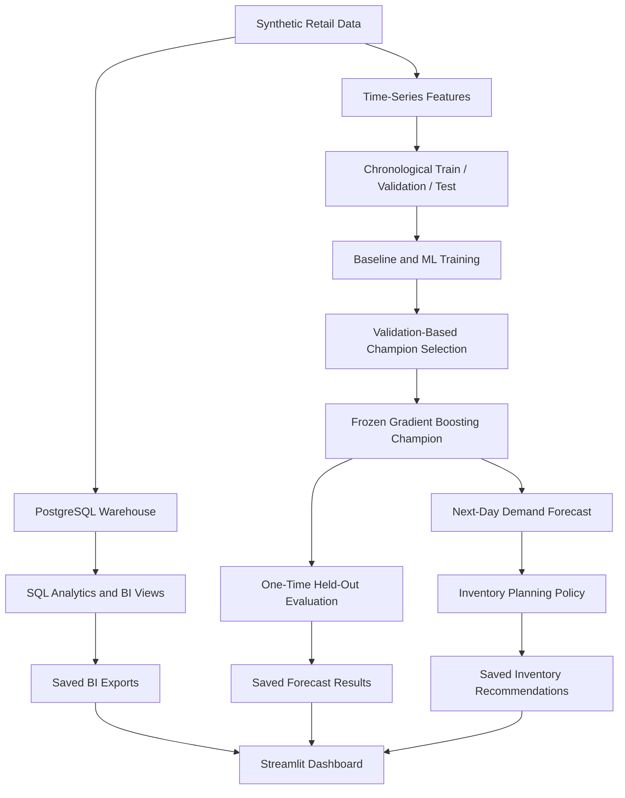
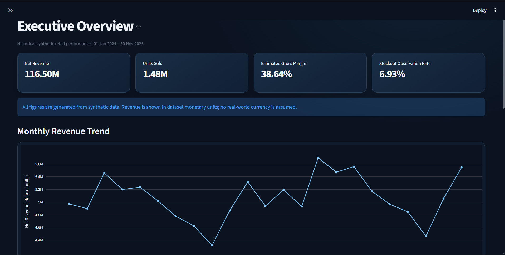
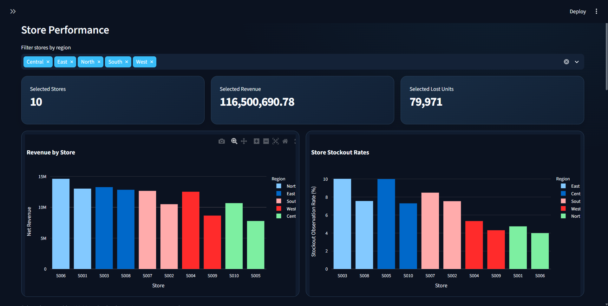
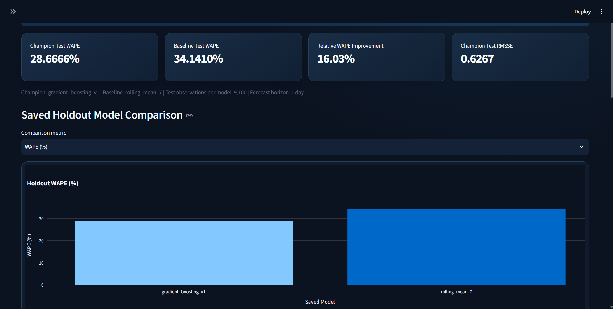
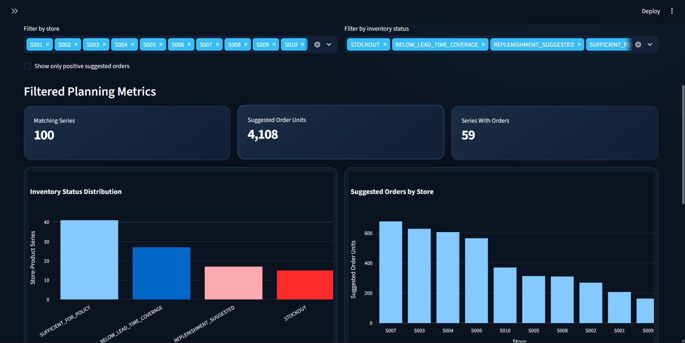

# RetailPulse AI 2.0

End-to-End Retail Analytics, Demand Forecasting and Inventory Intelligence

## Overview

RetailPulse AI 2.0 is an end-to-end synthetic retail analytics
and machine learning portfolio project.

It combines Python, PostgreSQL, SQL analytics, demand forecasting,
inventory planning, and a four-page Streamlit dashboard.

All business data and recommendations are synthetic and illustrative.

## Project Highlights

| Metric | Result |
|---|---|
| Retail observations | 70,000 |
| Stores | 10 |
| Products | 10 |
| Historical coverage | 2024-01-01 to 2025-11-30 |
| Net revenue | 116,500,690.78 synthetic currency units |
| Units sold | 1,483,884 |
| Stockout rate | 6.93% |
| Forecast champion | Gradient Boosting |
| Champion test WAPE | 28.67% |
| Baseline test WAPE | 34.14% |
| Relative WAPE improvement | 16.03% |
| Inventory combinations | 100 |
| Suggested order units | 4,108 |
| Automated tests | 404 passed |

## Architecture

The architecture separates business reporting from forecasting and inventory planning.

The dashboard reads saved artifacts without retraining models.

## Technology Stack

- Python 3.11
- PostgreSQL
- SQLAlchemy and Psycopg
- Pandas and NumPy
- Scikit-learn
- Streamlit and Plotly
- Pytest and Ruff
- Git

## Forecasting Methodology

The forecasting task predicts one-day-ahead sales for
100 store-product combinations.

Chronological split:

| Dataset | Date range | Rows |
|---|---|---|
| Training | 2024-01-29 to 2025-05-31 | 48,900 |
| Validation | 2025-06-01 to 2025-08-31 | 9,200 |
| Held-out test | 2025-09-01 to 2025-11-30 | 9,100 |

The champion was selected using validation performance
before the held-out test was evaluated exactly once.

The evaluation uses rolling one-day-ahead predictions
with observed historical lag features. It is not a
fixed-origin multi-step forecast.

Saved held-out results:

| Model | WAPE | RMSSE | Bias |
|---|---|---|---|
| Gradient Boosting | 28.67% | 0.6267 | +0.38% |
| Rolling Mean 7-day | 34.14% | 0.7372 | -0.93% |

## Inventory Planning

The planning snapshot covers December 1, 2025.

- 100 store-product combinations
- 59 combinations with suggested orders
- 4,108 total suggested units
- 15 combinations currently stocked out
- Two-day safety-stock policy
- Supplier lead-time coverage

Open purchase orders are excluded.
Recommendations are illustrative, not actual purchase orders.

## Streamlit Dashboard

Four interactive pages:

1. Executive Overview
2. Retail Performance
3. Forecast Performance
4. Inventory Planner

The dashboard reads committed BI, forecast evaluation,
and inventory planning artifacts.

It does not retrain models or rerun the held-out test.

## Dashboard Screenshots

The four-page Streamlit dashboard presents business performance,
forecast evaluation, and inventory planning in one interface.

### Executive Overview

### Retail Performance

### Forecast Performance

### Inventory Planner

## Getting Started

Prerequisites:

- Python 3.11
- Git
- PostgreSQL for database-dependent pipeline stages

Clone the GitHub repository after publication.

Create a virtual environment:

    python -m venv .venv

Activate it in Windows PowerShell:

    .\.venv\Scripts\Activate.ps1

Install dependencies:

    python -m pip install -r requirements.txt

Launch the dashboard:

    python -m streamlit run src/dashboard/app.py

Open:

    http://localhost:8501

## Optional Database Configuration

For PostgreSQL-dependent workflows, create a local
.env file containing:

    DB_HOST=localhost
    DB_PORT=5432
    DB_NAME=retailpulse_db
    DB_USER=retailpulse_app
    DB_PASSWORD=YOUR_LOCAL_PASSWORD

Never commit real database credentials.

## Quality Checks

Run:

    python -m ruff check config scripts src tests

    python -m pytest tests -q

Verified result: 404 automated tests passed.

## Reproducibility and Limitations

- All retail observations are synthetic.
- Dashboard CSV and JSON artifacts are committed.
- Raw datasets and trained model binaries are excluded.
- The dashboard can run without PostgreSQL.
- New model inference requires the compatible trained model.
- Held-out results are descriptive and are not reused for tuning.
- Inventory recommendations are not production purchase orders.

## Technical Documentation

- docs/phase4_business_intelligence.md
- docs/phase5_forecasting.md
- docs/phase6_explainability_error_analysis.md
- docs/phase7_forecast_serving_inventory.md
- docs/phase8_streamlit_dashboard.md

## Portfolio Skills Demonstrated

SQL, PostgreSQL, Python, ETL, business intelligence,
time-series forecasting, model evaluation, explainability,
inventory decision support, Streamlit, automated testing,
and Git-based project organization.